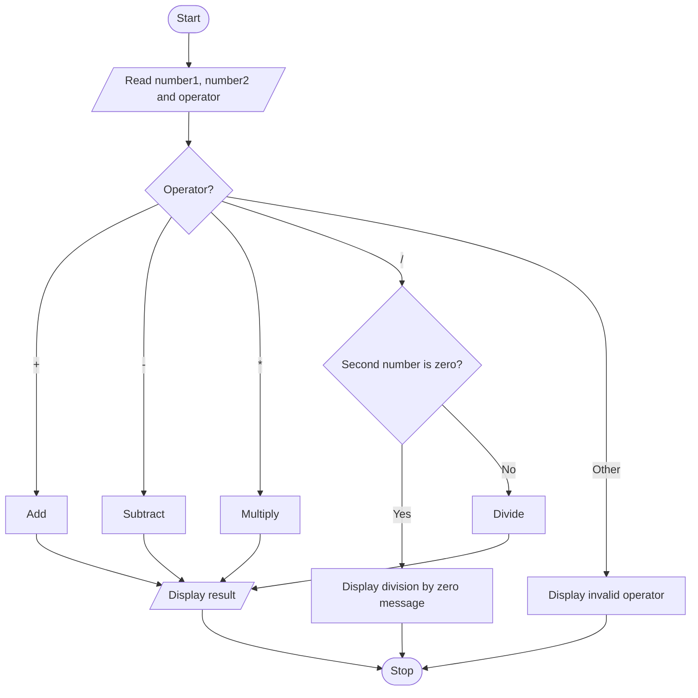

# Algorithm

1. Start.
2. Read the first number.
3. Read the second number.
4. Read the arithmetic operator.
5. If the operator is `+`, add the two numbers.
6. Else if the operator is `-`, subtract the second number from the first.
7. Else if the operator is `*`, multiply the two numbers.
8. Else if the operator is `/`, check whether the second number is zero.
   - If it is zero, display a division-by-zero message.
   - Otherwise, divide the first number by the second.
9. If the operator is not supported, display an invalid-operator message.
10. Display the result when an operation is completed.
11. Stop.

## Flowchart

