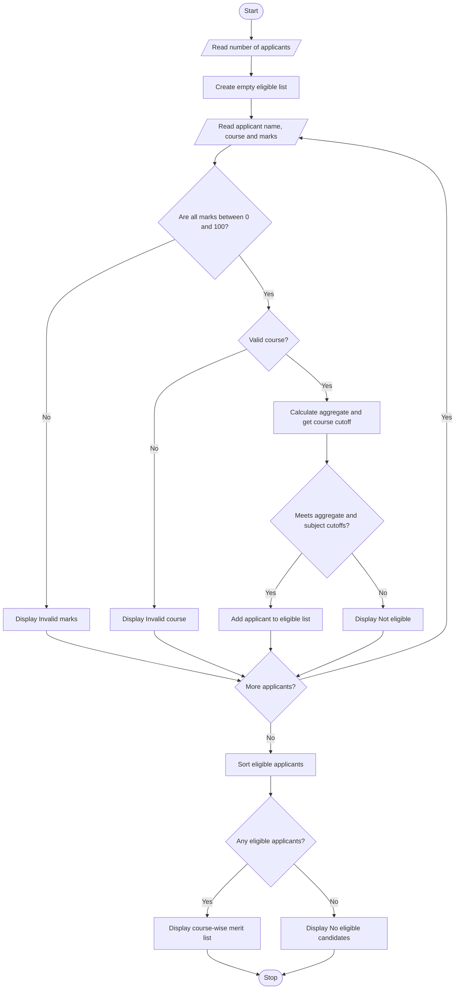

# Algorithm

1. Start.
2. Read the number of applicants.
3. Create an empty list named `eligible`.
4. Repeat for each applicant:
   - Read the applicant's name and course.
   - Read Mathematics, Physics, and Chemistry marks.
   - Check whether all marks are between 0 and 100.
   - If marks are invalid, display a message and move to the next applicant.
   - Calculate the average aggregate.
   - Select the cutoff and minimum subject mark based on the course.
   - If the course is invalid, display a message and move to the next applicant.
   - Check aggregate and all three minimum subject marks.
   - If eligible, add the applicant's details to the list; otherwise display not eligible.
5. Use selection sort to arrange eligible applicants by the stated merit rules.
6. Display the merit list course-wise and assign ranks within each course.
7. If no applicants are eligible, display that no eligible candidates were found.
8. Stop.

## Flowchart

The flowchart is a high-level view; the nested loops used for selection sort are shown in the algorithm and source code.
