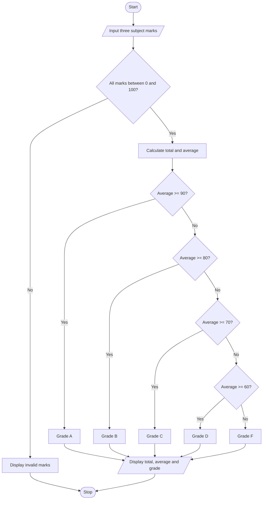

# Algorithm

1. Start.
2. Read marks in three subjects.
3. Check whether every mark is between 0 and 100.
4. If any mark is outside this range, display an invalid-marks message and stop.
5. Calculate total = mark1 + mark2 + mark3.
6. Calculate average = total / 3.
7. If average is 90 or above, assign grade A.
8. Else if average is 80 or above, assign grade B.
9. Else if average is 70 or above, assign grade C.
10. Else if average is 60 or above, assign grade D.
11. Otherwise, assign grade F.
12. Display total, average, and grade.
13. Stop.

## Flowchart

