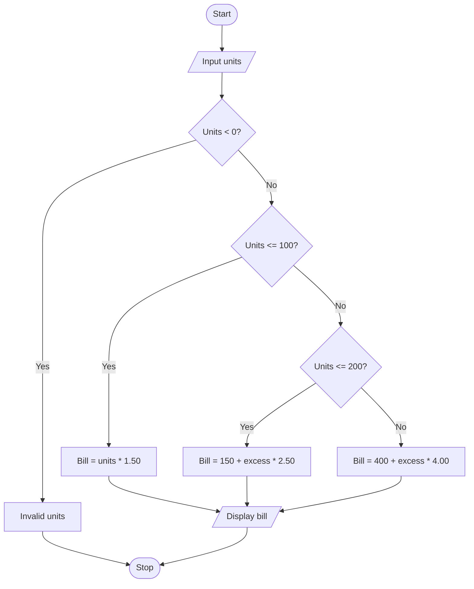

# Algorithm

1. Start.
2. Read units consumed.
3. If units are negative, display invalid input.
4. If units <= 100, bill = units * 1.50.
5. Else if units <= 200, bill = 150 + (units - 100) * 2.50.
6. Otherwise, bill = 400 + (units - 200) * 4.00.
7. Display bill and stop.

## Flowchart

