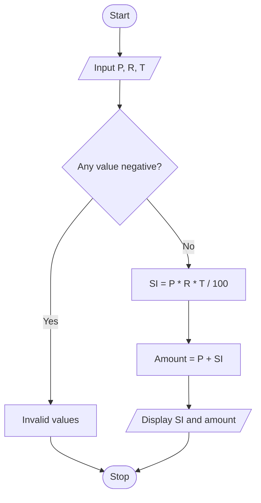

# Algorithm

1. Start.
2. Read principal, rate and time.
3. Check that all values are non-negative.
4. Calculate SI = P * R * T / 100.
5. Calculate total amount = P + SI.
6. Display SI and total amount.
7. Stop.

## Flowchart

