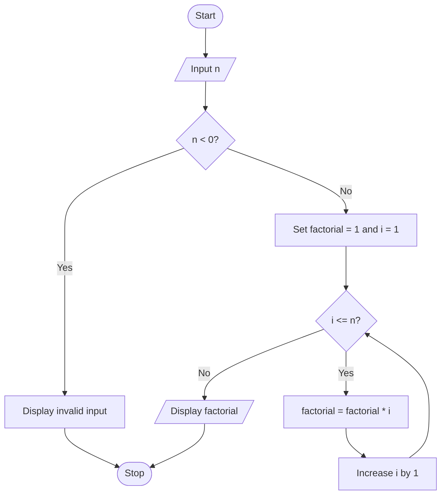

# Algorithm

1. Start.
2. Read n.
3. If n is negative, display invalid input.
4. Otherwise set factorial = 1.
5. Repeat i from 1 through n and multiply factorial by i.
6. Display factorial and stop.

## Flowchart

