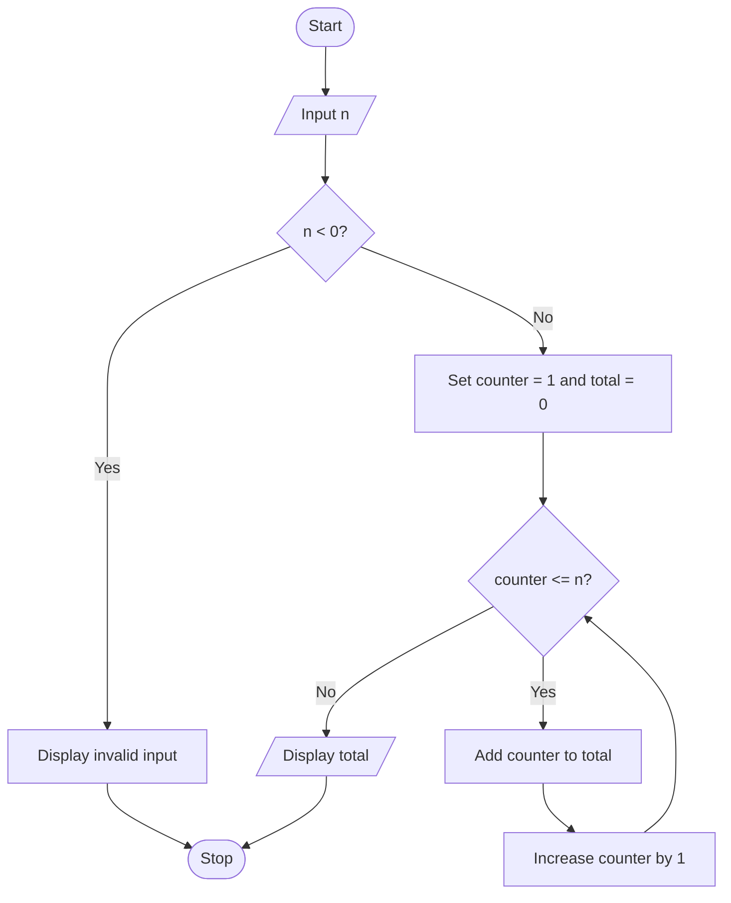

# Algorithm

1. Start.
2. Read n.
3. If n is negative, display invalid input.
4. Set counter = 1 and total = 0.
5. While counter <= n, add counter to total and increase counter by 1.
6. Display total and stop.

## Flowchart

