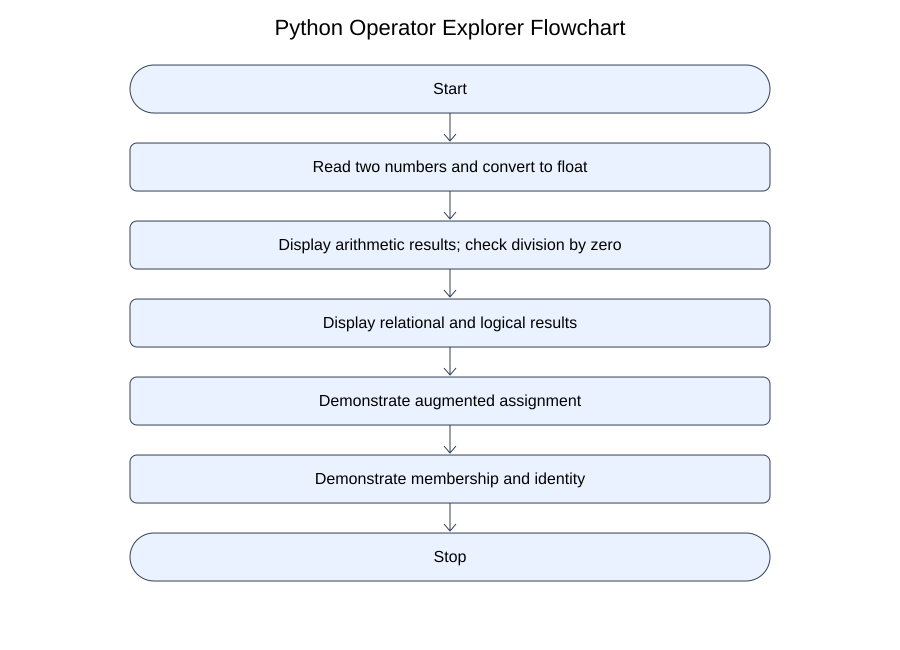
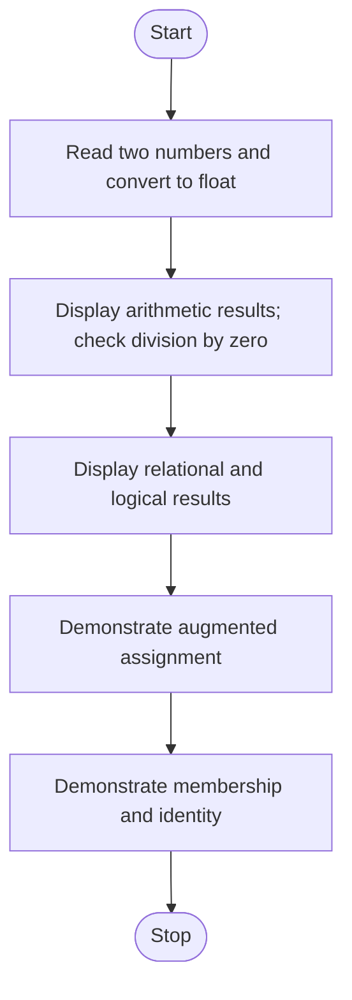

# Algorithm

1. Start.
2. Read two numbers and convert to float.
3. Display arithmetic results; check division by zero.
4. Display relational and logical results.
5. Demonstrate augmented assignment.
6. Demonstrate membership and identity.
7. Stop.

## Flowchart





## Pseudocode
```text
START
INPUT a,b
DISPLAY arithmetic operations
IF b != 0 DISPLAY a/b ELSE DISPLAY division warning
DISPLAY comparisons and logical result
count = 5; count += 2; DISPLAY count
word = 'python'; DISPLAY 'py' IN word
other = word; DISPLAY other IS word
STOP
```
