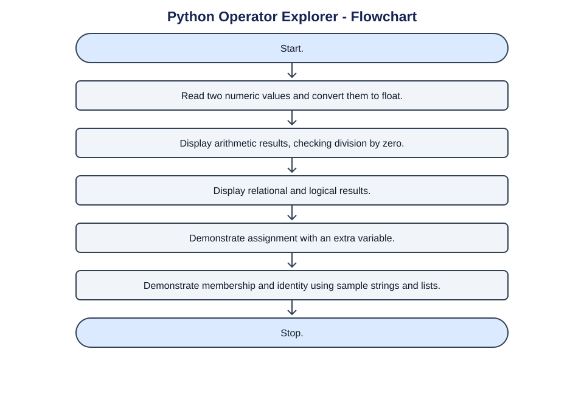
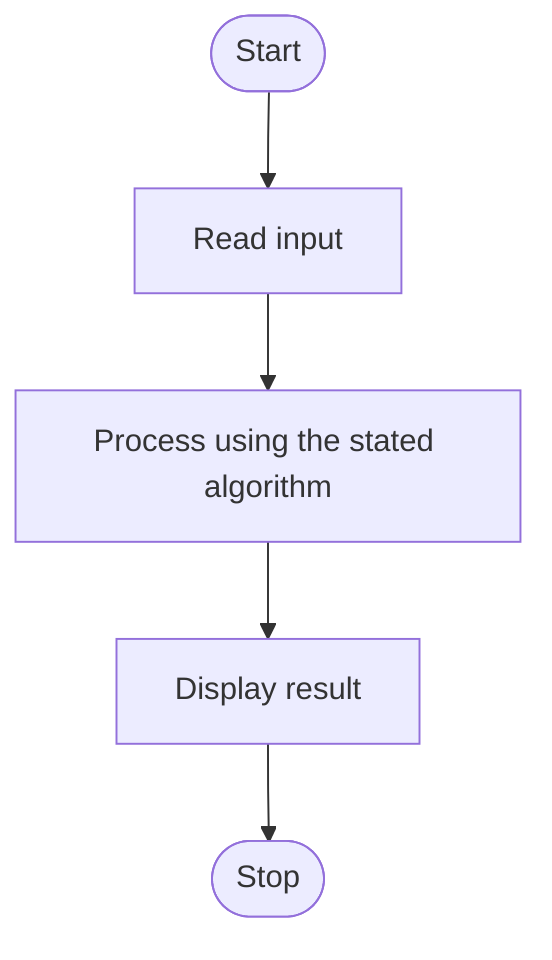

# Algorithm

Start.
Read two numeric values and convert them to float.
Display arithmetic results, checking division by zero.
Display relational and logical results.
Demonstrate assignment with an extra variable.
Demonstrate membership and identity using sample strings and lists.
Stop.

## Flowchart

