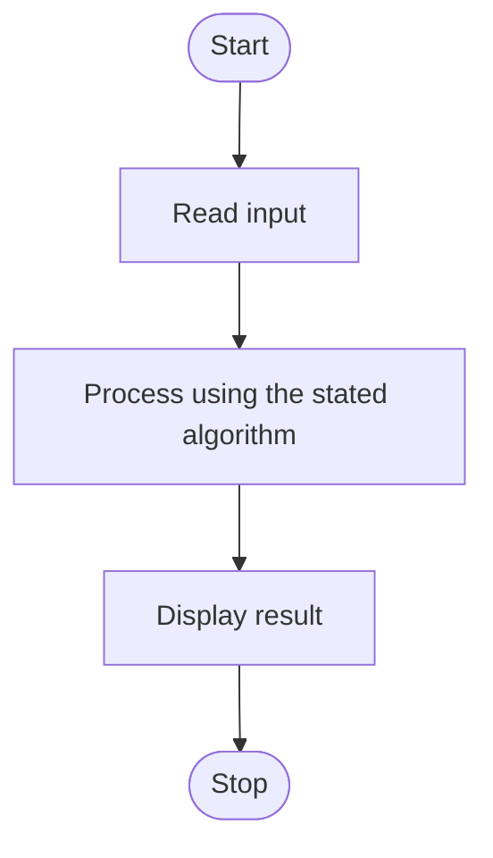

# Algorithm

Start.
Read a sentence.
Remove extra spaces at both ends.
Display length, upper, lower and title forms.
Split the sentence and count words.
Display results using f-strings.
Stop.

## Flowchart

